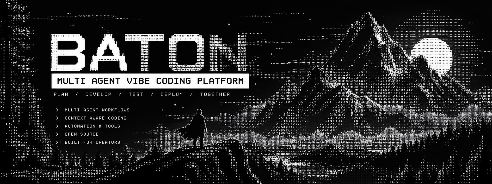
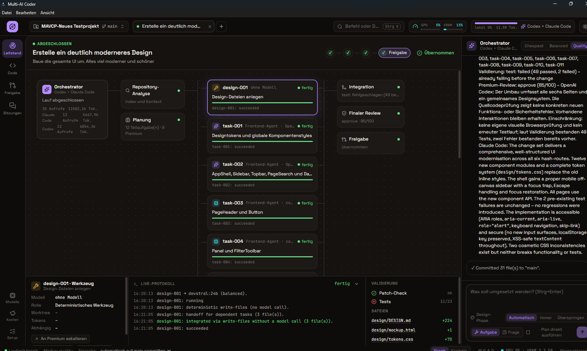
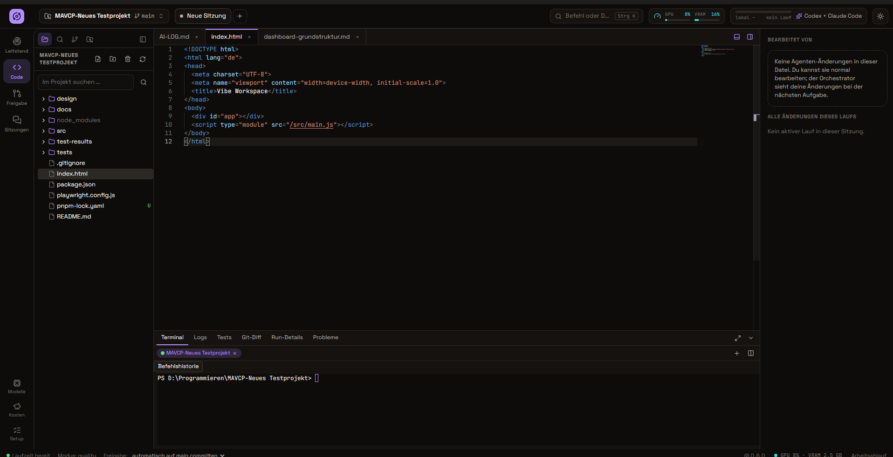
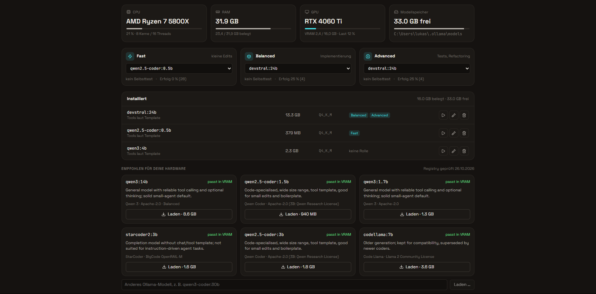
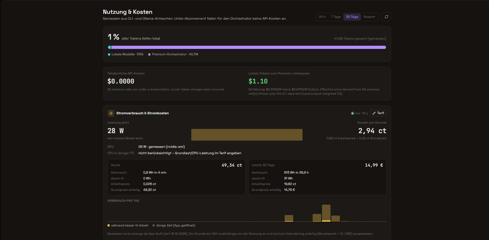
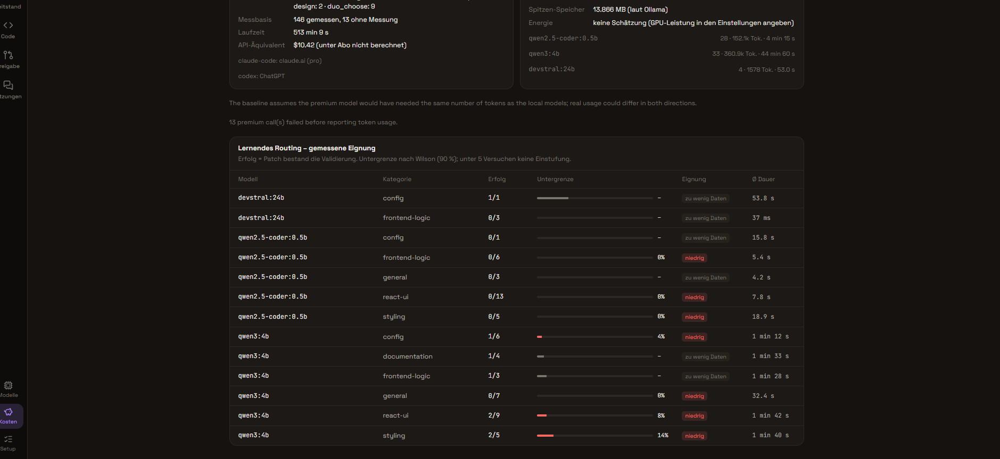
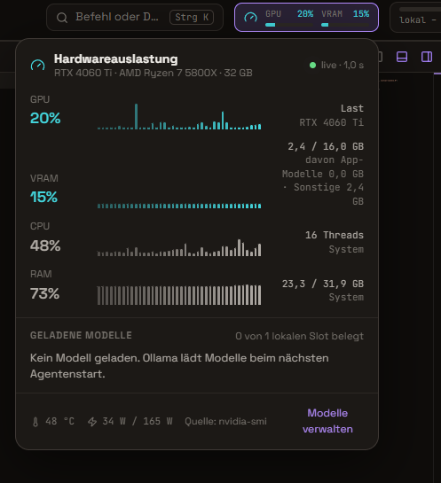
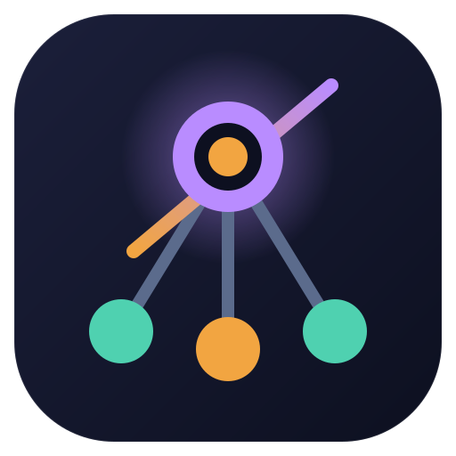

<div align="center">



<br>

**A desktop coding IDE where Claude Code or Codex plans the work,<br>small local models on your GPU take over as much of the implementation as they can,<br>and nothing lands without your approval.**

<br>


[**Quick start**](#-quick-start) · [**How it works**](#-how-it-works) · [**Features**](#-features) · [**Benchmarks**](#-benchmarks) · [**Architecture**](docs/desktop-architecture.md) · [**Contributing**](#-contributing)

</div>

---

```text
       .                     .    .                         _..._
                                         .                .'   ,-'     .
                                       +      /\          |   (            ·
          /\                            *    /''\         '.   `-.   +
         /''\              .                /'.''\          `'''` /\
        /' ''\          /\                 /''   '\.   *         /''\     .
       /''   '\        /''\      /\       /'  .  ''\     *      /' ''\    /\
      /'     ''\  /\  /' ''\    /' \     /''       '\  /\      /''   '\  / '\
    /\          \/ '\/      \  /   '\   /            \/' \    /        \/'   \
   / '\         /'   \       \/'     \ /             /   '\  /         /     '\
  /    \       /      \      /     :  \   /\        /    : \/         /        \
 /      \   /\/       :\    /    :     \ /  \      /   :    \ /\     /       :
/        \ / .\     :   \  /  /\        /.   \    /  :       /. \   /      :  /\
  ^ ^  ^  ^    ^ ^  ^     ^ ^   ^    ^ ^     ^  ^  ^      ^  ^  ^     ^  ^  ^
 /|/|\/|\/|\  /|/|\/|\   /|/|\ /|\  /|/|\   /|\/|\/|\    /|\/|\/|\   /|\/|\/|\
________________________________________________________________________________
   ~~      ~       ~~~        ~      ~~        ~     ~    .-=-.      ~~    ~
       ~        ~~         ~~       ~         ~~        ~  -=~=~=-   ~       ~~
  ~       ~~         ~         ~~        ~        ~         ~=~=~      ~~
      ~~        ~        ~~         ~         ~~      ~      -~-    ~        ~

              ~  your premium AI conducts  ·  local models play  ~
```

## ✨ Why Baton?

Premium coding agents are brilliant, but every token they write comes out of your subscription quota. Local models are free and private, but on their own they get lost in large tasks.

**Baton combines both.** The premium model does what it is best at: understanding the repo, splitting the request into small, precise single-file tasks and reviewing the result. Your local models do the typing. Every change is built in its own git worktree, checked by patch validation, typecheck and tests, and only applied after you click *approve*.

| | Premium agent alone | Local model alone | **Baton** |
|---|:---:|:---:|:---:|
| Understands large repos | ✅ | ⚠️ | ✅ |
| Offloads work to free local models | ❌ | ✅ | ✅ |
| Code stays on your machine during implementation | ❌ | ✅ | ✅ |
| Isolated worktree + tests before every change | ⚠️ | ❌ | ✅ |
| You approve every diff | ⚠️ | ⚠️ | ✅ |

> **Uses your existing login.** Baton drives the official `claude` and `codex` CLIs you have installed and signed in yourself. No API keys are stored, no tokens are scraped.

<br>

<div align="center">
  
  <br><sub>The <b>Leitstand</b> (control center): Codex and Claude Code planned 12 sub-tasks, agents executed them, the final review approved, and the result was committed.</sub>
</div>

## 🎼 How it works

```text
  You ──► "Fix clamp() for negative boundaries"
             │
             ▼
  ┌─────────────────────┐   repo index, symbols, import graph
  │  1. Context         │   token-budgeted digest (outlines, not whole files)
  └──────────┬──────────┘
             ▼
  ┌─────────────────────┐   Claude Code  ─or─  Codex   (your subscription)
  │  2. Plan            │   → tasks with files, risk, deps, acceptance criteria
  └──────────┬──────────┘
             ▼
  ┌─────────────────────┐   DAG + scheduler: file locks, VRAM-aware slots
  │  3. Route + queue   │   fast · balanced · advanced · premium
  └──────────┬──────────┘
     ┌───────┼───────┐
     ▼       ▼       ▼
  ┌──────┐┌──────┐┌──────┐   one git worktree per task
  │ AI A ││ AI B ││ AI C │   local Ollama agents, scoped tools, secrets redacted
  └──┬───┘└──┬───┘└──┬───┘
     └───────┼───────┘
             ▼
  ┌─────────────────────┐   patch checks → typecheck → tests → lint
  │  4. Validate        │   serial cherry-pick onto an integration branch
  └──────────┬──────────┘
             ▼
  ┌─────────────────────┐   risk-based premium review, one bounded fix round
  │  5. Review          │
  └──────────┬──────────┘
             ▼
  ┌─────────────────────┐   working copy · keep branch · fast-forward · undo
  │  6. You approve     │   Baton never pushes.
  └─────────────────────┘
```

**Fast Path:** formatting, lint fixes, organizing imports and renames are detected by rules and run with deterministic tools (Prettier, ESLint, the TypeScript language service) — zero model calls, still fully validated. Small single-file requests skip premium planning entirely.

## 🚀 Features

<table>
<tr>
<td width="50%" valign="top">

### 🎩 Orchestration
- **Claude Code** or **OpenAI Codex** as planner and reviewer, via their official CLIs
- **Duo mode:** both orchestrators plan in parallel and reconcile
- Structured plans with strict JSON schemas
- Cost modes: Cheapest · Balanced · Quality
- Adaptive routing based on measured success rates
- Deterministic fallback planner when no orchestrator is available

</td>
<td width="50%" valign="top">

### 🤖 Local models
- **Ollama** runtime, installed by the app on request
- Model catalog: Qwen Coder, Qwen 3, Devstral, gpt-oss, DeepSeek Coder …
- Real tool-call self-test before a model is marked verified
- Hardware detection and VRAM-aware parallelism
- Model tiers: Fast · Balanced · Advanced

</td>
</tr>
<tr>
<td valign="top">

### 🛡️ Safety by design
- One isolated **git worktree** per task
- Patch validation: path traversal, secrets, deny lists, scope, conflict markers, syntax
- Local agents get **no shell**, only scoped file tools
- Electron hardened: context isolation, sandbox, CSP, validated IPC
- Runtime only on `127.0.0.1` with a per-start bearer token

</td>
<td valign="top">

### 🧰 A real IDE
- Monaco editor with split view, diff tabs and local history
- Integrated terminals (xterm + node-pty)
- TypeScript language service: go to definition, references, rename, live diagnostics
- Project search & replace (ripgrep), command palette, quick open
- Git view, test results, run history

</td>
</tr>
<tr>
<td valign="top">

### 🔌 Extensible
- **52 bundled skills** (React, testing, accessibility, migrations, Blender, …)
- **Integration catalog:** 30 MCP server templates, 40 extra skills, 8 workflow packs
- **MCP** with per-tool and per-agent permissions, OAuth support
- **Plugin SDK** (`@multi-ai-coder/plugin-sdk`) for commands and views

</td>
<td valign="top">

### 📊 Transparency
- Every model call is logged: premium vs. local, tokens, inference time, peak memory
- Real spend vs. API list-price equivalent
- Electricity usage and cost per day, measured via `nvidia-smi`
- Diagnostics dashboard: CPU, RAM, GPU/VRAM, tokens/s, p50/p95 latencies

</td>
</tr>
</table>

## 📸 Screenshots

<table>
<tr>
<td width="50%" valign="top"><br><p align="center"><b>Code</b><br><sub>Explorer, Monaco editor, terminal, logs, tests and git diff in one window.</sub></p></td>
<td width="50%" valign="top"><br><p align="center"><b>Local models</b><br><sub>Fast, Balanced and Advanced tiers, installed models and recommendations that fit your VRAM.</sub></p></td>
</tr>
<tr>
<td width="50%" valign="top"><br><p align="center"><b>Usage &amp; costs</b><br><sub>Measured token split, real API spend vs. list-price equivalent, and electricity cost from <code>nvidia-smi</code>.</sub></p></td>
<td width="50%" valign="top"><br><p align="center"><b>Learning routing</b><br><sub>Success rate per model and task category with a Wilson lower bound, decides what goes local.</sub></p></td>
</tr>
</table>

<p align="center"><br><sub><b>Live hardware monitor:</b> GPU, VRAM, CPU, RAM, temperature, power draw and loaded models.</sub></p>

> The UI is currently in German. English localization is on the roadmap.

## ⚡ Quick start

**Requirements**

- Node.js ≥ 22, pnpm 10, Git
- One orchestrator CLI, signed in via its official login: `claude` (Claude Code) or `codex` (Codex CLI)
- Recommended: [Ollama](https://ollama.com) — the app can install it via winget/brew after you confirm

No PostgreSQL, Redis or Docker needed: Baton uses a local SQLite database and a built-in job queue.

```bash
git clone https://github.com/Lamboserker/Multi-agent-Vibe-Coding-Plattform.git baton
cd baton
pnpm install
pnpm prisma:generate
pnpm dev            # builds everything and starts the desktop app (Electron)
```

<details>
<summary><b>Dev tips</b></summary>

- `MAC_DEVTOOLS=1 pnpm dev` additionally opens the renderer DevTools.
- Starting from a VS Code terminal? The dev script removes `ELECTRON_RUN_AS_NODE` automatically (VS Code sets it, which would make Electron behave like plain Node).
- App data (database, worktrees, logs) lives in
  - Windows: `%APPDATA%\Multi-AI Coder`
  - macOS: `~/Library/Application Support/Multi-AI Coder`
  - Linux: `~/.config/Multi-AI Coder`

</details>

<details>
<summary><b>Build an installer</b></summary>

```bash
pnpm package:desktop   # → apps/desktop/release/Multi-AI Coder Setup <version>.exe (Windows NSIS)
```

macOS (`dmg`) and Linux (`AppImage`, `deb`) targets are configured in `apps/desktop/electron-builder.yml` and must be built on the respective OS.

</details>

<details>
<summary><b>Legacy web UI (optional)</b></summary>

```bash
pnpm dev:web        # local runtime on 127.0.0.1:4000 + Next.js UI on http://localhost:3000
```

The web UI uses its own user login; the desktop app is the primary interface. The old BullMQ worker (`pnpm dev:legacy-worker`) is superseded by the built-in job queue and needs Redis.

</details>

## 📈 Benchmarks

Measured on an RTX 4060 Ti (16 GB), Ryzen 7 5800X, 32 GB RAM, with `qwen3:4b` (Q4_K_M) as the local model. Time until a validated, approval-ready result:

| Task | Before optimization | After | Faster |
|---|---:|---:|---:|
| Fix a bug in `clamp` | 82.8 s | **10.7 s** | 87 % |
| Add and export `slugify` | 263.0 s | **157.7 s** | 40 % |
| Introduce a shared tax helper across 3 files | 176.6 s | **12.0 s** | 93 % |

Small sample, all runs and raw data are published: [performance report](docs/performance-2026-10-15.md) · [UI execution report](docs/benchmarks/ui-execution-optimization-2026-10-15.md) · reproducible benchmark: `packages/engine/bench/task-latency.mjs`.

## 🗂️ Project structure

```text
.
├── apps/
│   ├── desktop/        Electron app (main process + React/Vite renderer)
│   ├── api/            local NestJS runtime: planning, agents, skills, MCP, plugins
│   ├── web/            legacy Next.js web UI
│   └── worker/         legacy BullMQ worker
├── packages/
│   ├── engine/         orchestrator adapters, planner, router, scheduler, agents, git, validation
│   ├── agents/         agent prompts and profiles
│   ├── plugin-sdk/     public plugin API
│   └── shared/         shared types, routing, integration catalog
├── prisma/             SQLite schema and additive migrations
├── skills/             52 bundled skills
└── docs/               architecture, decisions, benchmarks
```

## 🧪 Tests

```bash
pnpm --filter @multi-ai-coder/engine test     # worktrees, patches, scheduler, router, agents, adapters …
pnpm --filter @multi-ai-coder/api test
pnpm --filter @multi-ai-coder/desktop test    # IPC validation
pnpm typecheck
```

Engine tests run against real git and real test runners; the orchestrator adapters are tested against fake CLIs with recorded event formats. The live end-to-end test (real Ollama model + real orchestrator) is opt-in, see [`apps/desktop/e2e/README.md`](apps/desktop/e2e/README.md).

## 🧭 Roadmap

- [x] Windows installer, SQLite runtime, crash recovery
- [x] Claude Code and Codex adapters, Duo orchestration
- [x] Fast Path, prepared local execution, diagnostics dashboard
- [x] Skills, MCP, plugins, integration catalog
- [ ] English UI
- [ ] Signed installers and tested macOS / Linux builds
- [ ] OS-level sandbox for project test commands
- [ ] Semantic code search (embeddings)

## ⚠️ Honest limitations

- macOS and Linux packages are configured but only built and tested on Windows so far.
- Installers are not code-signed yet (SmartScreen warning on Windows).
- Project validation commands run as your user inside the worktree with an allowlist and a secret-free environment. That is policy isolation, not an OS sandbox.

## 🤝 Contributing

Issues, ideas and pull requests are very welcome.

1. Fork the repo and create a branch: `git checkout -b feat/my-idea`
2. Run `pnpm typecheck && pnpm test` before opening a PR
3. Keep migrations additive and follow the style of the surrounding file

New here? Start with [docs/desktop-architecture.md](docs/desktop-architecture.md) and [docs/ide-features.md](docs/ide-features.md).

<div align="center">

<br>



**If Baton saves you quota or time, a ⭐ helps others find it.**

<sub>Built by <a href="https://github.com/Lamboserker">Lamboserker</a> · <a href="https://veluna-labs.de">VELUNA-Labs</a></sub>

</div>
